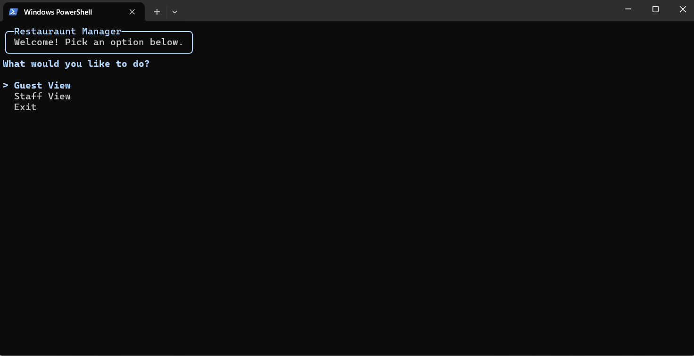
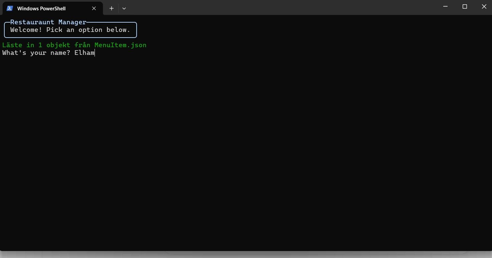
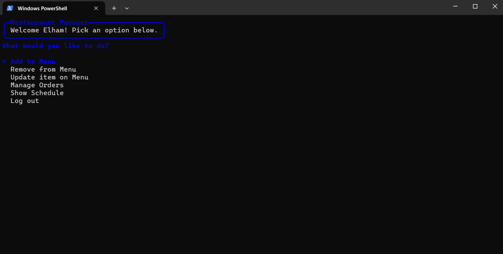

# Haven – Restaurant Management System

Haven is a console-based restaurant management application developed in C# using .NET 10 as a group project at NBI Handelsakademin.

The application provides separate interfaces for guests and restaurant staff. Guests can browse the restaurant menu, place food orders, check order status, and manage reservations. Staff members can manage menu items, handle orders, and view their working schedules.

The application uses Spectre.Console to create an interactive and colorful terminal interface.

## Features

### Guest Features

- View the restaurant menu
- Create food orders
- Check order status
- Make reservations
- View reservations
- Cancel reservations

### Staff Features

- Register and log in
- Add new menu items
- Update existing menu items
- Remove menu items
- View and manage orders
- Update order status
- View working schedules
- Log out
- Reset passwords using a simulated reset code

## Technologies

- C#
- .NET 10
- Spectre.Console 0.57.2
- Object-Oriented Programming (OOP)
- JSON for data storage
- Git and GitHub

## Project Structure

```text
Grupp_project_Restaurang/
├── RestaurangSystem/
│   ├── Models/
│   ├── Services/
│   ├── UI/
│   ├── Program.cs
│   └── RestaurangSystem.csproj
├── RestaurangSystem.Tests/
├── screenshots/
│   ├── start-menu.png
│   ├── guest-menu.png
│   └── staff-menu.png
└── README.md
```

- **Models:** Contains the application's data models.
- **Services:** Contains application logic, authentication, logging, and data storage.
- **UI:** Contains interactive menus and console interface components.
- **Program.cs:** Entry point of the application.
- **RestaurangSystem.Tests:** Contains automated tests.

## How to Run

### Requirements

- .NET 10 SDK
- Git
- A terminal or an IDE such as Visual Studio Code

### Installation

1. Clone the repository:

```bash
git clone https://github.com/NooriaR/Grupp_project_Restaurang.git
```

2. Navigate to the project directory:

```bash
cd Grupp_project_Restaurang
```

3. Run the application:

```bash
dotnet run --project RestaurangSystem/RestaurangSystem.csproj
```

4. Select **Guest View** or **Staff View** from the start menu.

## Screenshots

### Start Menu

The main menu allows users to choose between Guest View and Staff View.



### Guest Menu

Guests can view the restaurant menu, create orders, check order status, and manage reservations.



### Staff Menu

Staff members can manage menu items, handle orders, and view their working schedules.



## Team

This project was developed as a group assignment during the System Developer .NET program at NBI Handelsakademin.

## Version Control

The project uses Git and GitHub for collaboration, including feature branches, pull requests, and code reviews.
